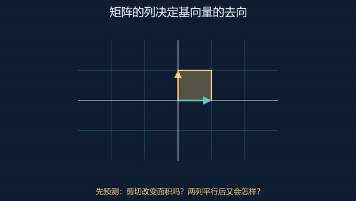

# 3Blue1Brown 中文导学教材 · LaTeX + Lean + Manim

**[在线阅读教材](https://vitael04213.github.io/3blue1brown-notes/)** · **[交互实验室](https://vitael04213.github.io/3blue1brown-notes/lab.html)** · **[下载 92 页 PDF](dist/3blue1brown-notes-zh.pdf)**

围绕官方课程序列独立编写的中文导学教材：6 组课程、66 个独立条目、67 个通过 Lean 检查的定理。每课从问题出发，用连续论述解释概念为何出现、表示如何选择、公式如何推导，再用算例、自测和形式化边界检查理解。

逐课引导正文包含约 2.5 万个汉字，另有每章综合推导练习、数学回顾与详细算例。LaTeX 和网页共用正文，既可连续阅读，也可回到原课对照学习。

先预测两根基向量将落在哪里，再到[矩阵实验](https://vitael04213.github.io/3blue1brown-notes/lab.html#linear)调整两列，观察面积和定向。

## 怎样使用

1. 先读每节的问题与引导推导，尝试自己完成下一步。
2. 按观课提示观看原视频或官方图文，再播放对应动画。
3. 改一个实验参数，先预测后观察，用公式解释差异。
4. 遮住答案完成自测；最后核对 Lean 定理里的条件和覆盖范围。

网页按需嵌入 **61 个官方原视频**；另外 **5 个目录条目未单列视频 ID**，直接链接官方图文和图示。原视频需要网络访问，无法加载时仍保留原链接。没有编造对应关系或未核实的时间点。

**9 组原创 Manim 动画**均提供中文说明、MP4 和 GIF；**9 个参数实验**支持播放、暂停、重置和键盘调节。PDF 包含动画关键帧及网页入口；动画和参数操作在网页中进行。完整媒体清单与重制方法见 [媒体说明](media/README.md)。

## 覆盖范围

官方目录快照：2026-10-24。

| 课程 | 目录位置 | 阅读入口 |
|---|---:|---|
| 线性代数 | 16 | [向量与坐标](https://vitael04213.github.io/3blue1brown-notes/lessons/vectors.html) |
| 微积分及补充课 | 17 | [从面积发现微积分](https://vitael04213.github.io/3blue1brown-notes/lessons/essence-of-calculus.html) |
| 神经网络、Transformer、扩散模型 | 11 | [神经网络基本单元](https://vitael04213.github.io/3blue1brown-notes/lessons/neural-networks.html) |
| 微分方程、傅里叶、拉普拉斯 | 10 | [从局部规律到演化](https://vitael04213.github.io/3blue1brown-notes/lessons/differential-equations.html) |
| Lockdown Math | 11 | [基础数学导读](https://vitael04213.github.io/3blue1brown-notes/lessons/lockdown-math-announcement.html) |
| 压缩与智能 | 2 | [熵与编码](https://vitael04213.github.io/3blue1brown-notes/lessons/entropy.html) |

共 67 个目录位置；交叉熵在两组中共享，所以是 66 个独立条目。公告页作为导读，65 节数学课有 Lean 对照。范围为上述官方课程序列，不包括所有独立专题、外部演讲或未来新课。[逐课目录](COURSES.md)保留完整英文标题和来源。

这是原创中文伴读教材，包含独立的例子、推导与教学组织，不是逐字字幕翻译，也不声称逐帧观看全部视频。官网提供正文的课程参照其概念组织，只有视频入口的部分依据核实主题独立展开标准数学。来源记录见 [retrieval.json](sources/retrieval.json)。

## 证明覆盖

[FORMALIZATION.md](FORMALIZATION.md)逐课列出实际验证的命题与边界。67 个定理由 Lean 检查，无未完成证明或自设公理。

- 有些证明是一般定理，有些是特例或局部恒等式。
- 微积分基本定理保留可导性与可积性条件，克拉默法则保留非零行列式条件。
- 幂塔命题证明“若迭代收敛，其极限是不动点”，不把收敛当成已证结论。
- KL 非负性针对严格正且归一化的有限分布。
- 一般 PDE 理论、傅里叶收敛、网络泛化与生成质量没有被局部计算冒充为完整形式化。

章节综合练习提供纸笔推导，形式化范围仍以逐课命题为准。[验证记录](VALIDATION.md)包含 PDF、网页、实验与 Lean 的实际检查结果。

## 本地复现

### 阅读网页

下载仓库后可直接打开 docs/index.html。正文的 MathML、原创动画和交互实验不依赖第三方 CDN；原视频仍需要网络。也可启动本地服务：

    python -m http.server 8000 --directory docs

浏览器打开 http://localhost:8000。

### 编写与重建网页

    python -m pip install -r requirements-authoring.txt
    python scripts/build_site.py
    node scripts/check_models.cjs
    python scripts/check_textbook.py

网页从 notes/guides/、notes/chapters/ 和 notes/reviews/ 生成。每课的观课提示与实验关联保存在 media/teaching.json。生成的 notes/media/ 同时供 PDF 使用。

浏览器回归检查：

    python -m playwright install chromium
    python scripts/check_browser.py

### PDF

使用 Tectonic 0.17.0 或含 ctex、Fandol、TikZ、AMS、hyperref 的 XeLaTeX：

    python scripts/build_pdf.py

若编译器不在 PATH，指定 --tectonic /absolute/path/to/tectonic。输出到 dist/；正文使用 Fandol 字体。9 张关键帧已经随仓库提供，重编 PDF 不需要先安装 Manim。

### Lean

先按 [Lean 官方说明](https://lean-lang.org/install/)配置 Elan，再运行：

    lake exe cache get
    lake build
    python scripts/audit.py
    lake env lean scripts/AxiomAudit.lean

固定 Lean 4.19.0、mathlib v4.19.0 和全部传递依赖提交。首次下载数学库缓存可能占用数 GB，后续复用本地缓存。

## 来源与许可

原课程归 Grant Sanderson / 3Blue1Brown 及署名合作者；扩散模型客座课程署名 Stephen Welch / Welch Labs。本项目没有官方隶属关系。

原创讲解、证明、Manim 场景和参数实验使用 [MIT 许可](LICENSE)。外部原视频通过官方播放器引用，原图示通过官方图文页引用；其权利仍归原作者。没有把第三方素材重新许可为本项目内容。
